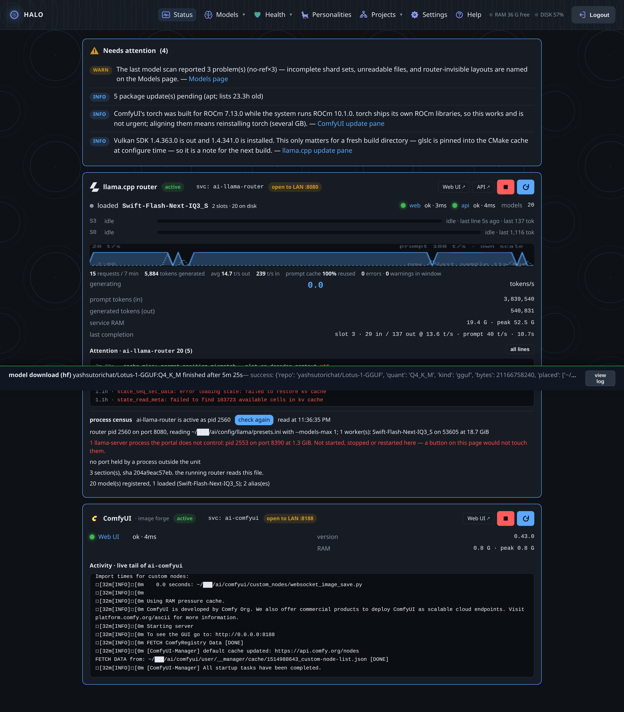

# HALO — the AI Tool Management Portal

**One desktop machine. All the AI. No cloud.**

A web console that manages, updates, and connects the AI tools on a single
AMD Strix Halo box: the llama.cpp router, ComfyUI, model files, projects,
coding agents, and the machines next door.

This project began as a personal challenge: **can a fully functional Edge AI
tools management portal be built using only edge AI tools** — models running
on the family's Framework Desktop (AMD Ryzen AI Max+ 395, 128 GB shared
memory)? The answer, so far, is yes. The portal was planned, written, tested,
and reviewed by coding agents running on the machine it manages, and the
portal in turn launches those agents. Nothing here rents intelligence.

> Screenshots are from the live portal, scrubbed of private data at capture:
> addresses, account paths, and token-shaped text are masked before the
> pixels exist.



## What it does

| Page | The short story |
|---|---|
| **Status** | The router and ComfyUI at a glance: live tokens-per-second, cache reuse, per-slot activity, service logs, and an attention list that says what needs you. |
| **Models** | Every model in the library, decoded from the files themselves — quant, size, context, what the router can see — plus a migration planner that moves them safely. |
| **Get Models** | Name a Hugging Face model with a quant, and the portal plans the download, verifies every byte, and files it where the router will find it. |
| **Health** | The machine tells the truth: GPU aperture, driver coupling (ROCm ↔ llama.cpp ↔ torch), pending updates, disk — and the portal never applies system updates itself. |
| **Personalities** | Bind a model, its settings, and a coding agent into a named voice. The router loads what the moment needs. |
| **Projects** | Point at a folder, pick a personality, and a real coding session starts — reachable from the browser, durable across restarts. |
| **Workroom** | Where the machines post their work to each other: findings, reports, questions — quarantined until the owner promotes them. |
| **Settings** | Network bind per service, firewall lines shown before they are run, agent tokens for the mesh, router key management. |

That's the summary. The long form lives in the showcase:

- [**Features**](docs/showcase/features.md) — each page, with pictures.
- [**Milestones**](docs/showcase/milestones.md) — what this project has survived and shipped.
- [**The edge mesh**](docs/showcase/mesh.md) — a Windows box, a Mac on the way, and a portal that keeps the record.
- [**Engineering**](docs/showcase/engineering.md) — how it stays trustworthy: 1,366 tests, no build step, laws written down.

## The milestones people ask about

- **The 4096-token mystery.** A flagship model loaded cleanly and reported a
  4096-token context — a "broken model" that was really a 64 GiB driver cap
  on the GPU's view of memory. The fix (a proper TTM module setting, worked
  out by the owner) raised the window to 108 GiB, and the portal now checks
  the aperture and warns when a kernel update quietly resets it.
- **llama.cpp, kept alive.** Update, build (HIP + Vulkan), release registry,
  symlink farm, rollback — one button, no footnotes, no surprise rebuilds.
- **Models you can plan with.** The portal decodes GGUF files — quant,
  architecture, trained context — and turns that into router "personalities"
  and honest memory budgets.
- **A harness you can reach from anywhere.** Projects launch real coding
  sessions with a personality attached; the session view keeps working when
  you close the laptop.
- **Downloads that can't lie.** A `-hf` spec plans the bytes up front and
  verifies them at the door; the 21.4 GB witness run landed exactly as
  planned, with the model filed into the router's library.
- **A mesh, not a script.** The Windows box next door reads the portal's
  knowledge base, posts measured A/B tests to a shared Workroom bench, and
  its writes land quarantined until the owner promotes them. A 128 GB
  MacBook is next.

## Under the hood, in one paragraph

FastAPI and Jinja — no front-end build step, so the test suite drives every
page in a real DOM. One SQLite base (jobs, models, memories, mesh, events)
with FTS5 and vector recall. The portal audits everything it does and never
takes destructive action without a confirmation. The project's own journal
(records from day one), its environment survey, and its design proposals
are all in [`docs/`](docs/) — searchable from inside the portal by the AI
agents themselves, through a door the portal built for them.

## Run it

Ubuntu 26.04 on AMD Strix Halo is the home, but the parts (llama.cpp,
ComfyUI, Hugging Face tooling) are standard. See
[START_HERE](docs/START_HERE.md) for the tour and
[ENVIRONMENT](docs/ENVIRONMENT.md) for the machine the portal was built on.

```bash
./deploy/install.sh
systemctl --user restart ai-portal   # then open the printed URL
```

Written by Carolyn Hudson with the help of the machines it manages.
